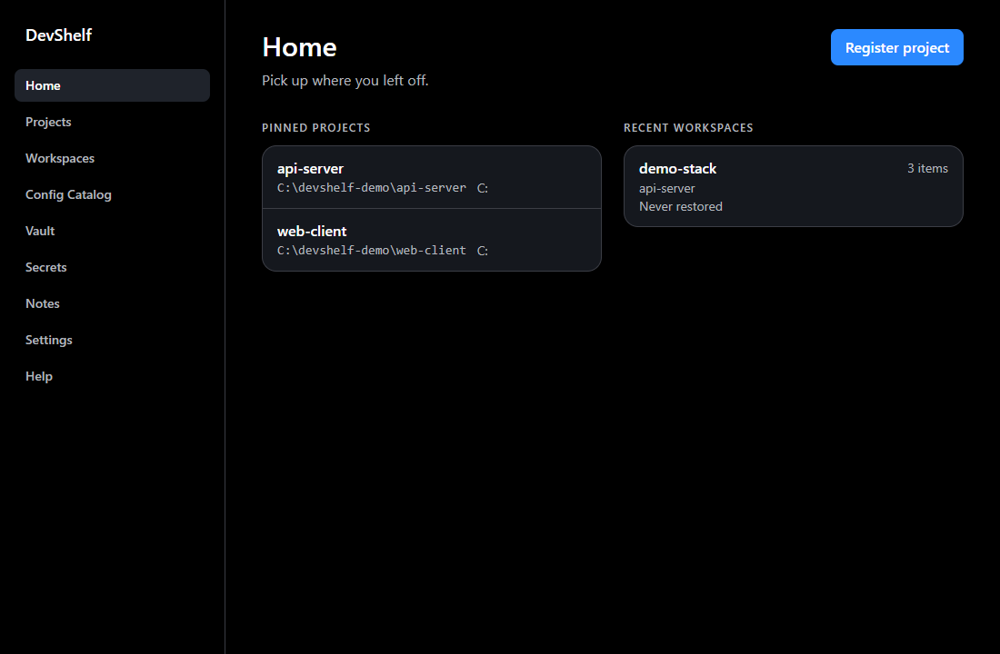
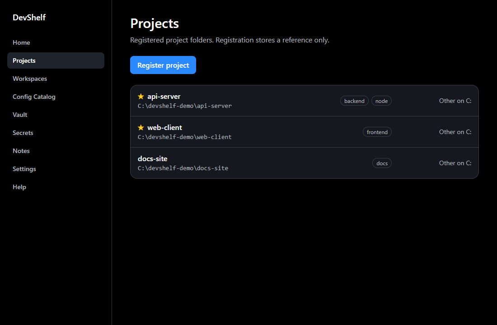
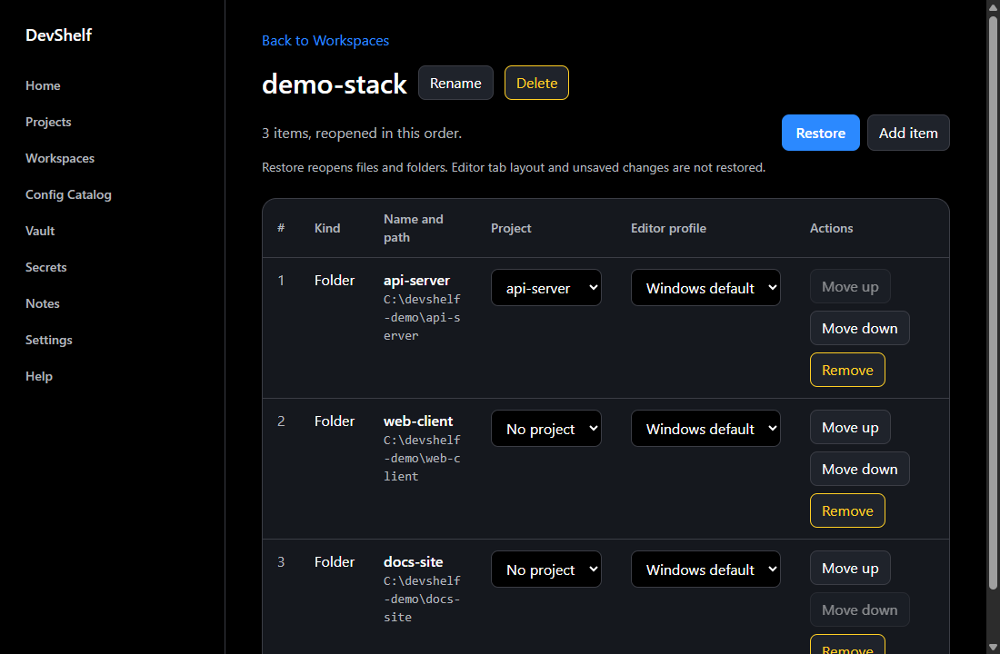
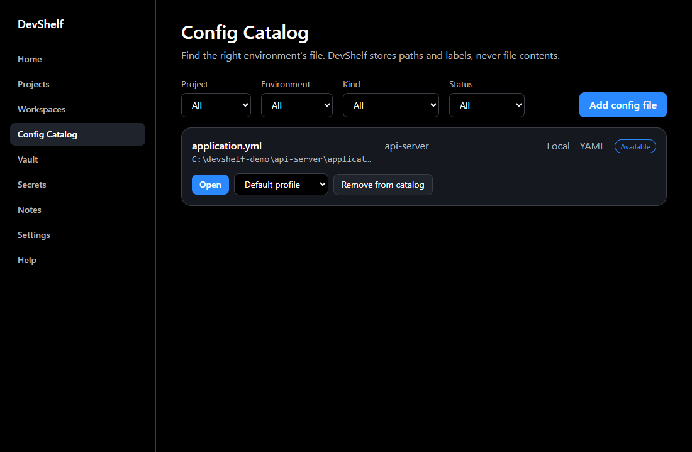
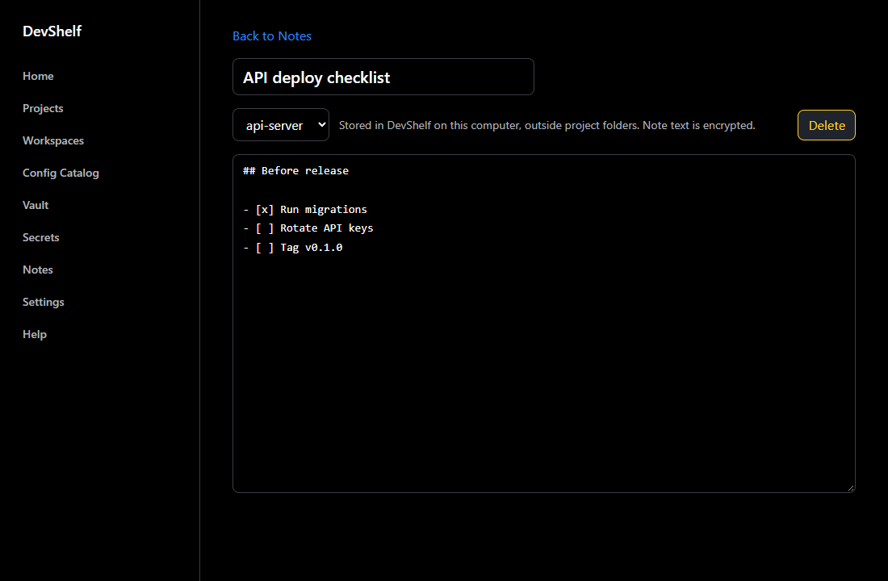
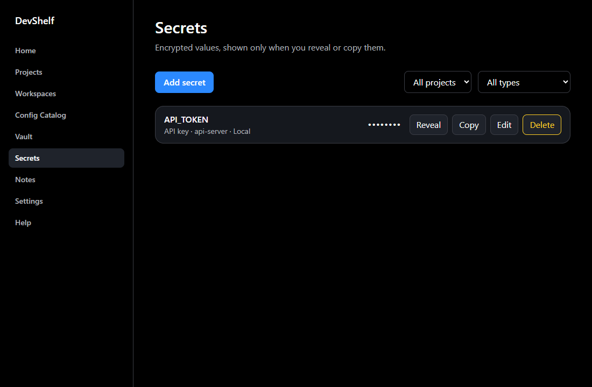
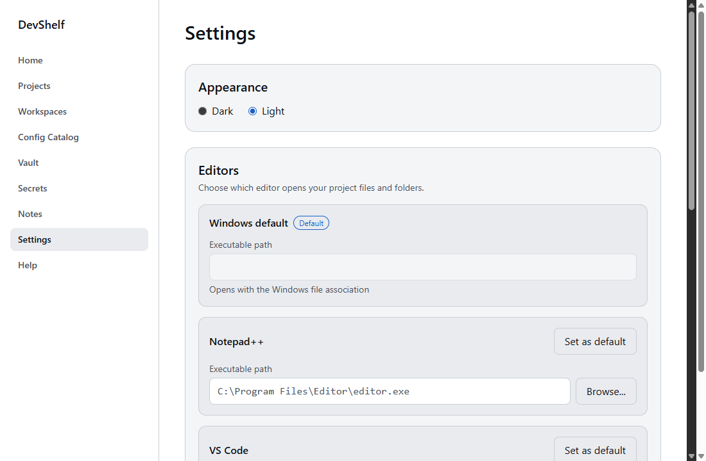

# DevShelf

DevShelf is a single-user, offline Windows desktop app that organizes your projects, editor profiles, workspaces, config references, private notes, and an encrypted secrets vault. No cloud, sync, telemetry, or network calls.



## Features

- **Projects**: register a project by folder and pin the ones you use most.
- **Editor profiles**: add an editor by executable and arguments. Shell syntax is rejected.
- **Workspaces**: build from projects and paths, then restore in one action. The restore result lists missing items, with Relink or Ignore for each.
- **Config catalog**: track config files per project and environment (local, dev, staging, production). Status is Available, Missing, or Inaccessible.
- **Notes**: private Markdown notes linked to a project. Bodies are encrypted and autosave one second after you stop typing.
- **Vault and secrets**: master password of at least 12 characters, with no recovery. Auto-lock after 1, 5, or 15 minutes, or never. Secrets stay masked, reveal hides again after 30 seconds, and copy puts the value on the clipboard without showing it.
- **Home**: pinned projects and recent workspaces at a glance.
- **Appearance**: Dark (default) or Light.

## Requirements

| To run the installed app | To build from source |
| --- | --- |
| Windows 10/11 x64 | Node.js 22 with npm (the version CI uses) |
| WebView2 runtime (preinstalled on Windows 11 and current Windows 10) | Rust stable with the MSVC toolchain and Visual Studio C++ Build Tools |
| | Git. Cargo is at `%USERPROFILE%\.cargo\bin` |

## Install

### Option A: build the installer

```powershell
git clone https://github.com/KhoaLy2003/devshelf.git
cd devshelf
npm install
npm run tauri build
```

Then run `src-tauri\target\release\bundle\nsis\DevShelf_0.1.0_x64-setup.exe`, or the `.msi` in `src-tauri\target\release\bundle\msi\`. You can also run `src-tauri\target\release\devshelf.exe` directly.

The installer is not code-signed, so SmartScreen may warn on first run. Choose **More info**, then **Run anyway**. No prebuilt release is published for this repository.

### Option B: run in development mode

```powershell
git clone https://github.com/KhoaLy2003/devshelf.git
cd devshelf
npm install
npm run tauri dev
```

## Using DevShelf

1. **Register a project.** Open Projects, choose **Register project**, and pick the folder. Pin it to show it on Home.

   

2. **Add an editor profile.** In Settings, add an editor with its executable and arguments.
3. **Build and restore a workspace.** Open Workspaces, create a workspace, add projects or paths, then choose **Restore**. Restore reopens files and folders in the order you set. Tab layout and unsaved editor buffers are not restored.

   

4. **Track config files.** In Config Catalog, choose **Add config file** and set the project, environment, and kind.

   

5. **Write a note.** Open Notes, choose **New note**, and start typing. It saves automatically.

   

6. **Create the vault, then add secrets.** Open Vault, set a master password of at least 12 characters, and confirm you understand there is no recovery. Then open Secrets and choose **Add secret**. Values stay masked until you reveal or copy them.

   

7. **Switch to Light theme.** In Settings, under Appearance, choose Light.

   

The in-app Help screen has full guides, troubleshooting, and the changelog.

## Your data and privacy

- DevShelf stores its data in `%APPDATA%\app.devshelf.desktop`.
- Secrets and note bodies are encrypted. The note encryption key is stored in Windows Credential Manager.
- Project names, tags, environment names, and file paths are stored unencrypted in the local database.
- If you forget the vault master password, the vault cannot be recovered.
- Unregistering a project removes only the registration. Project files are not touched.

## Development

Commands:

- `npm run tauri dev`: run the app in development mode.
- `npm run build`: typecheck and Vite build.
- `npm run test`: Vitest.
- `npm run lint`: ESLint and Prettier check. `npm run format` writes Prettier fixes.
- In `src-tauri/`: `cargo test` and `cargo build`.

Repository layout:

- `src/`: React + TypeScript UI. `src/lib/commands.ts` wraps Tauri commands; `src/types/commands.ts` holds the shared command types.
- `src-tauri/src/`: Rust core. `commands/` holds the Tauri commands. Domain modules are `projects`, `editors`, `workspaces`, `config`, `notes`, `vault`, and `secrets`. `db/` handles SQLite persistence.
- `tests/`: Vitest tests.
- `docs/`: architecture, constitution, design, roadmap, and models.
- `.github/workflows/`: CI (lint, build, Vitest, cargo test).

Tech stack: Tauri 2 (WebView2), React, TypeScript, Vite, Rust, and SQLite (`rusqlite` with bundled SQLite and `rusqlite_migration`). Details are in [docs/architecture.md](docs/architecture.md).

## Contributing

Coding standards: [docs/constitution.md](docs/constitution.md).

- **File naming**: kebab-case for TypeScript/TSX files and folders (`app.tsx`, `quick-open.ts`); snake_case for Rust files and modules (`project_registry.rs`). One folder per Rust domain module.
- **Tests**: TypeScript tests live in `tests/` and are named `*.test.ts` or `*.test.tsx`. Rust tests live in `#[cfg(test)]` modules beside the code, or in `src-tauri/tests/` for integration tests. Tests use temporary directories, never the real user data folder.
- **Commit messages**: Conventional Commits, `type(scope): summary` in the imperative mood, with types `feat`, `fix`, `docs`, `refactor`, `test`, `chore`, `ci` (for example `feat(projects): add project registry`).
- **Releasing**: `feat`, `fix`, `perf`, `refactor`, and breaking commits (`!` after the type, or a `BREAKING CHANGE:` footer) appear in `CHANGELOG.md`. Preview with `npm run release -- <patch|minor|major|X.Y.Z> --dry-run`, then run it without `--dry-run` on a clean tree, then `git push origin HEAD --follow-tags`. While the version is below 1.0, a breaking change or feature is a `minor` bump and a fix is a `patch`; use `major` only from 1.0.0 onward. Edit the in-app Help changelog (`src/lib/help-content.ts`) by hand before releasing.

## License

Private project. No license is granted.
